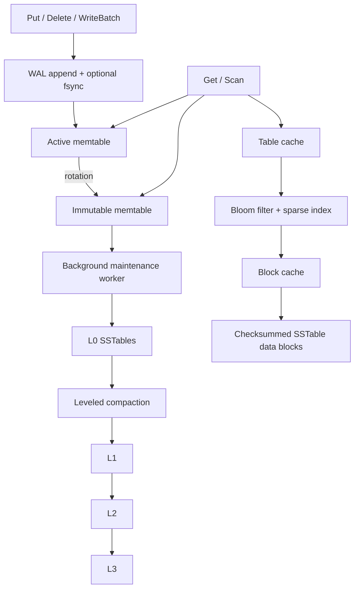

# CairnKV

CairnKV is a compact C++20 LSM-tree key-value storage engine built as an educational systems project. The implementation focuses on the core mechanisms of an LSM engine—durability, recovery, immutable sorted storage, caching, compaction, and background maintenance—while deliberately using conventional C++ and a limited concurrency model.

The project is designed to keep the difficult parts in the storage algorithms rather than in advanced language techniques or framework code.

> **Internal API note:** the C++ namespace and public include path remain `minilsm` for API stability; CairnKV is the project and repository name.

## Features

- Checksummed write-ahead log with crash recovery
- Atomic `WriteBatch` with contiguous sequence-number assignment
- Synchronous and asynchronous write durability modes
- Active and immutable `std::map` memtables
- One background maintenance worker for flush and compaction
- Hard write backpressure when maintenance cannot keep up
- Block-based SSTables with sparse indexes and Bloom filters
- Prefix-compressed data blocks with restart points
- Separate table and decoded-block LRU caches
- L0–L3 leveled organization
- Scored compaction selection with transitive L0 overlap closure
- Forward range scans with version/tombstone collapsing
- Complete MANIFEST snapshots selected through `CURRENT`
- Database-directory ownership through a POSIX lock
- Metadata-only and paranoid startup validation modes
- Corruption, crash, randomized differential, cache, concurrency, and parser tests
- Benchmark drivers for batching, caching, compression, and maintenance behavior

CairnKV intentionally does **not** implement SQL, replication, sharding, reusable MVCC snapshots, general transactions, secondary indexes, column families, or multiple compaction strategies.

## API example

```cpp
#include "minilsm/db.hpp"

int main() {
    minilsm::Options options;

    std::unique_ptr<minilsm::DB> db;
    auto status = minilsm::DB::Open(options, "example-db", &db);
    if (!status.ok()) {
        return 1;
    }

    minilsm::WriteBatch batch;
    batch.Put("customer:001", "Alice");
    batch.Put("customer:002", "Bob");
    batch.Delete("customer:003");

    status = db->Write(minilsm::WriteOptions{.sync = true}, batch);
    if (!status.ok()) {
        return 1;
    }

    auto found = db->Get("customer:001");

    auto scan = db->Scan("customer:", "customer;"); // [lower, upper)
    while (scan->Valid()) {
        // scan->key() and scan->value() refer to the current item.
        scan->Next();
    }

    if (!scan->status().ok()) {
        return 1;
    }

    status = db->Close();
    return status.ok() ? 0 : 1;
}
```

`Put` and `Delete` are implemented as single-mutation batches. A batch receives a contiguous sequence interval and is stored as one logical WAL frame. With `sync=true`, the WAL is synchronized before the complete batch becomes visible. With `sync=false`, visibility is still atomic, but the most recent acknowledged writes may be lost after a machine crash.

Keys and values are byte strings. User keys use unsigned-byte ordering. A point read captures the relevant in-memory and on-disk sources before performing table I/O. A range scan owns its creation-time memory state and pins the table readers it needs, so it can remain valid across flush, compaction, `Close()`, and DB destruction. This is an iterator-lifetime guarantee, not a reusable MVCC snapshot API.

## Architecture



### Write path

```text
WriteBatch
    -> validate batch
    -> allocate contiguous sequence numbers
    -> append one WAL frame
    -> fsync when requested
    -> atomically publish mutations to active memtable
    -> rotate when the memtable reaches its limit
    -> background flush immutable memtable to L0
    -> background compaction moves data through lower levels
```

The engine keeps one active memtable and at most one immutable memtable. If the active table fills while the immutable table is still being processed, writers wait. This intentionally simple policy keeps backpressure and lifecycle rules explicit.

### Read path

```text
Get
  -> active memtable
  -> immutable memtable
  -> overlapping L0 files, newest first
  -> at most one range candidate in each of L1-L3
  -> TableCache
  -> Bloom filter
  -> sparse block index
  -> BlockCache
  -> checksum/decode block on a cache miss
```

L0 files may overlap. L1–L3 maintain disjoint sorted user-key ranges. Newest visible values win; tombstones stop older values from becoming visible.

### Caching

`TableCache` stores reusable SSTable readers, including open file handles, sparse indexes, and Bloom metadata. `BlockCache` stores decoded immutable data blocks keyed by SSTable file number and block location.

Both are bounded LRU caches implemented with ordinary standard-library containers. Cache eviction removes residency but does not invalidate a reader or block already held by an in-flight operation.

### Compaction

Compaction uses level-pressure scores. L0 selection includes a complete transitive overlap closure before adding destination-level overlaps. Lower levels advance through the key space using a remembered compaction pointer.

Outputs are split only between user-key groups. Compaction keeps the newest required version of each key and retains tombstones whenever deeper data may still contain an older value.

See [docs/ARCHITECTURE.md](docs/ARCHITECTURE.md), [docs/COMPACTION.md](docs/COMPACTION.md), and [docs/CONCURRENCY.md](docs/CONCURRENCY.md).

## Persistence and recovery

`CURRENT` selects the authoritative complete MANIFEST snapshot. A MANIFEST records the live SSTables, sequence metadata, and the WAL identities needed for recovery.

The durability order is deliberately explicit:

```text
create/write new file
    -> fsync file
    -> rename when required
    -> fsync directory
    -> write/fsync replacement MANIFEST
    -> publish CURRENT
    -> fsync directory
    -> only then remove obsolete files
```

During memtable rotation, the durable metadata may name both the active WAL and the immutable WAL. The immutable WAL remains recoverable until its contents have been safely installed in an SSTable and the replacement MANIFEST is authoritative.

Normal startup validates metadata and checks individual data blocks when they are read. `paranoid_checks=true` additionally validates every referenced data block and cross-checks persisted table metadata.

See [docs/WAL_AND_RECOVERY.md](docs/WAL_AND_RECOVERY.md), [docs/WAL_BATCH_FORMAT.md](docs/WAL_BATCH_FORMAT.md), [docs/STORAGE_FORMAT.md](docs/STORAGE_FORMAT.md), and [docs/RECOVERY.md](docs/RECOVERY.md).

## Build

Requirements:

- C++20 compiler
- CMake 3.25+
- Ninja recommended
- POSIX environment for the current file-locking implementation

### Debug

```sh
cmake --preset debug
cmake --build --preset debug -j2
ctest --preset debug --output-on-failure
```

### Release

```sh
cmake --preset release
cmake --build --preset release -j2
ctest --preset release --output-on-failure
```

### ASan + UBSan

```sh
cmake --preset asan-ubsan
cmake --build --preset asan-ubsan -j2
ctest --preset asan-ubsan --output-on-failure
```

A direct compiler-based build/test driver is also included:

```sh
python3 tools/build_and_test.py --help
```

See [docs/TESTING.md](docs/TESTING.md) for the test matrix and coverage notes.

## Benchmarks

Build the Release configuration and run:

```sh
build/release/cairnkv_experiments --quick
build/release/cairnkv_experiments
```

The benchmark driver measures:

- WriteBatch throughput and latency
- block-cache hit rate and read work
- SSTable size with and without prefix compression
- point-read and scan throughput
- foreground versus background maintenance behavior
- compaction input/output work

Measured results and metric definitions are documented in [docs/BENCHMARKS.md](docs/BENCHMARKS.md).

An optional matched workload for LevelDB is included in `tools/compare_leveldb.cpp` and `tools/run_leveldb_comparison.py`. Performance comparisons should only be reported after both engines have been run in the same environment with the documented configuration.

## Documentation

| Topic | Document |
|---|---|
| Architecture and source map | [docs/ARCHITECTURE.md](docs/ARCHITECTURE.md) |
| Concurrency and worker lifecycle | [docs/CONCURRENCY.md](docs/CONCURRENCY.md) |
| WAL and recovery | [docs/WAL_AND_RECOVERY.md](docs/WAL_AND_RECOVERY.md) |
| WAL batch format | [docs/WAL_BATCH_FORMAT.md](docs/WAL_BATCH_FORMAT.md) |
| SSTable/storage format | [docs/STORAGE_FORMAT.md](docs/STORAGE_FORMAT.md) |
| Prefix compression and caches | [docs/PREFIX_AND_CACHES.md](docs/PREFIX_AND_CACHES.md) |
| Compaction | [docs/COMPACTION.md](docs/COMPACTION.md) |
| Testing | [docs/TESTING.md](docs/TESTING.md) |
| Benchmarks | [docs/BENCHMARKS.md](docs/BENCHMARKS.md) |
| Current scope | [docs/SCOPE.md](docs/SCOPE.md) |
| Known limitations | [docs/LIMITATIONS.md](docs/LIMITATIONS.md) |

## Intentional limits

CairnKV keeps its scope deliberately narrow:

- `std::map` memtables instead of a concurrent skip list
- one serialized writer and one background maintenance worker
- one immutable memtable slot with hard backpressure
- four fixed levels and one leveled compaction policy
- full MANIFEST snapshots instead of an incremental metadata log
- no reusable snapshots/MVCC
- no multi-key read/write transactions beyond atomic `WriteBatch` visibility
- no reverse iterators or range tombstones
- no secondary indexes, SQL layer, replication, or networking
- no custom allocator, direct I/O, lock-free data structures, or thread pool
- POSIX file and locking semantics rather than a portability layer
- cache capacities bound resident cache entries, not all memory or descriptors pinned by long-running scans

These limits are deliberate: the project emphasizes the core storage-engine algorithms and their correctness properties without trying to reproduce a production engine such as RocksDB.
